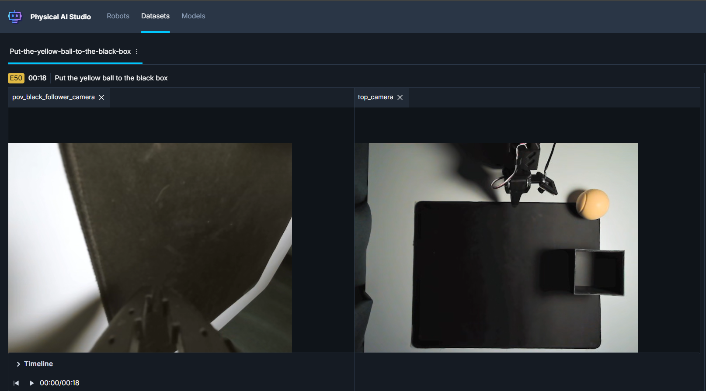
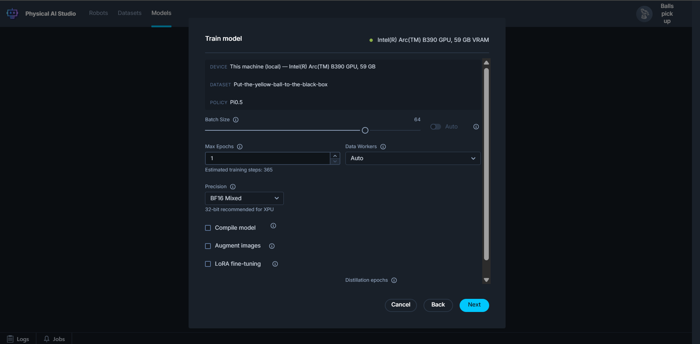
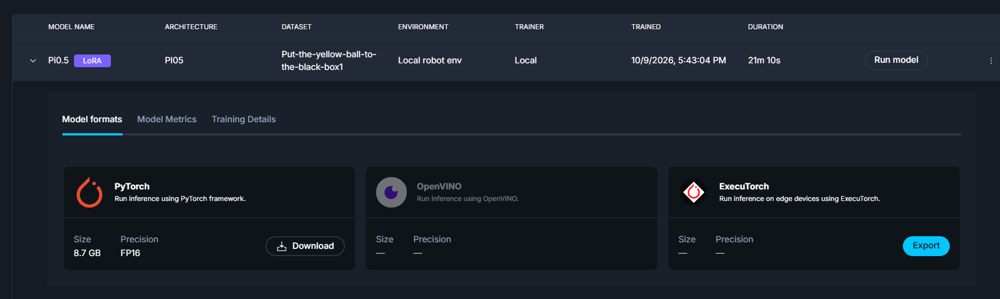
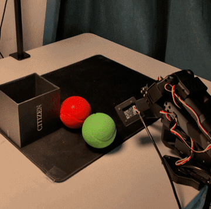
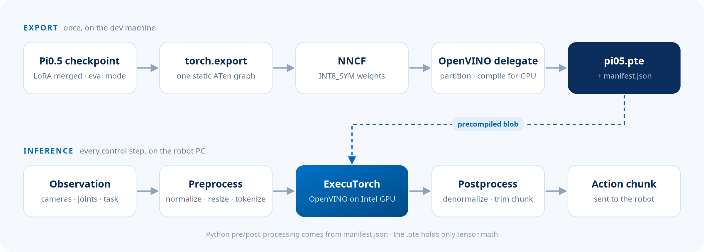

# From robot demonstrations to edge inference with ExecuTorch and OpenVINO

Robot manipulation has moved from hand-written motion planners to learned policies. Vision-language-action models such as Pi0.5 take camera frames, joint states, and a plain-language instruction, and predict a chunk of future actions — you demonstrate the behaviour instead of programming it. The hard part is rarely the model; it is capturing clean synchronized data, training on it, and then getting a multi-billion-parameter transformer to run fast enough on the machine next to the robot. That chain usually spans half a dozen tools, and every handoff is a chance for the input contract to drift.

**Physical AI Studio** keeps it in one application: record, train, export, and run the result back on the robot, with a Python API underneath for anything you want to automate. For deployment it builds on **ExecuTorch**, PyTorch's edge runtime, which packages a trained model into a self-contained `.pte` file with no Python interpreter at inference time. Its **OpenVINO delegate** routes supported subgraphs to Intel CPUs, GPUs, and NPUs, and falls back to portable kernels for the rest.

Here is that path end to end — a pick-and-place demonstration turned into a Pi0.5 policy, exported through ExecuTorch with the OpenVINO delegate, and run on an Intel XPU.

## 1. Capture the task in Studio

Follow the [Studio installation guide](application/docs/01-installation.md), connect a leader and follower arm and cameras, then create an environment and dataset. Teleoperate the pick-and-place task, return the robot home at the end of each episode, and keep only clean demonstrations. Pi0.5 is language-conditioned, so give the dataset a specific task string such as “pick up the brown cube and place it in the black box.” Start with around 50 consistent episodes; the [recording guide](application/docs/05-recording-datasets.md) shows how to review camera footage and joint traces before training.



## 2. Train a policy

In **Models → Train model**, select that dataset and **Pi0.5**, then follow the loss curve and logs. Pi0.5 pulls its backbone from Hugging Face Hub, so configure a read-scoped token in **Settings → General → Hugging Face** first. Save the checkpoint and training settings, and test the policy on held-out trials before exporting.



## 3. Export with the OpenVINO delegate

In Studio, open the trained model and look at its **Model formats** card: each backend — PyTorch, OpenVINO, ONNX, **ExecuTorch** — gets its own tile with an **Export** button. The ExecuTorch tile adds a **delegate** picker: choose **portable**, **XNNPACK**, or **OpenVINO**, select the target device, and Studio builds the delegated `.pte` for you in one click.



The same export is a single call through the Python API:

```python
from physicalai.policies import Pi05

policy = Pi05.load_from_checkpoint("/path/to/last.ckpt")
policy.eval()
policy.export(
    "./pi05-executorch-openvino",
    backend="executorch",
    delegate="openvino",
    delegate_config={"device": "GPU", "compress_weights": "int8_sym"},
)
```

This produces `pi05.pte` and `manifest.json`, which carries the policy's input/output contract — including the language input Pi0.5 expects at inference. `device="GPU"` targets the Intel XPU, and `compress_weights="int8_sym"` runs NNCF INT8 weight compression before the graph is handed to OpenVINO (more on that [below](#under-the-hood-pytorch-to-pte-to-intel-xpu)).

## 4. Run the exported policy on the robot

Back in Studio, hit **Run model** on the ExecuTorch format: choose the environment, enter the task string, and Studio wires the cameras and the follower arm to the `.pte` policy for you. Our demo runs on an Intel XPU machine, so the OpenVINO delegate executes the model on the integrated GPU while Studio streams observations and action chunks in real time.

The same artifact loads from Python — `InferenceModel` picks the ExecuTorch backend from the `.pte` extension and reads the input/output contract from `manifest.json`:

```python
from physicalai.inference import InferenceModel

policy = InferenceModel("./pi05-executorch-openvino")

obs, info = env.reset()
done = False
while not done:
    obs["task"] = "pick up the brown cube and place it in the black box"
    action = policy.select_action(obs)
    obs, reward, terminated, truncated, info = env.step(action)
    done = terminated or truncated
```



## Under the hood: PyTorch to `.pte` to Intel XPU

The Export button and `policy.export(...)` hide a pipeline that is worth understanding: it explains what ends up inside the `.pte`, what stays outside it, and why the result runs well on an Intel GPU.



### Export: from a PyTorch module to a delegated program

1. **Prepare the module.** If the policy was fine-tuned with LoRA, the adapters are merged into a disposable copy of the weights. Any `torch.compile` wrappers are removed, the model is put in eval mode, and it is moved to CPU, because ExecuTorch tracing does not support XPU or CUDA tensors.
2. **Capture the graph.** `torch.export.export` traces the model on a preprocessed, tensor-only sample input and produces an ATen-dialect `ExportedProgram`, a single static graph with no Python control flow.
3. **Compress the weights.** With `compress_weights="int8_sym"`, NNCF runs `compress_weights(..., mode=INT8_SYM)` on the exported module and the result is re-exported. Weights are stored as INT8 with per-channel scales, and activations stay in floating point. This needs no calibration data and roughly quarters the size of the linear and embedding weights compared with FP32.
4. **Partition.** `to_edge_transform_and_lower` converts the program to the Edge dialect and asks the `OpenvinoPartitioner` which nodes OpenVINO can run. Supported nodes are grouped into delegated subgraphs, and anything left over stays in the graph as an ExecuTorch portable kernel. For Pi0.5, practically the whole network ends up delegated.
5. **Compile ahead of time.** For each delegated subgraph, the OpenVINO backend's `preprocess` step converts the FX graph with OpenVINO's PyTorch frontend, compiles it for the device in the compile spec (`device=GPU`), and serializes the compiled model as an opaque blob. The usual OpenVINO graph optimizations, such as constant folding, operator fusion, and GPU kernel selection, happen here, at export time.
6. **Serialize.** `to_executorch()` writes the program, with the OpenVINO blobs embedded, to `pi05.pte`. Next to it, `manifest.json` records the input and output names, feature schema, and pre- and post-processing pipeline.

### Runtime: what happens on the robot PC

`InferenceModel` reads `manifest.json` and builds the pipeline around the `.pte`:

- **Preprocessors** run in Python, outside the graph. They normalize the joint state with the dataset statistics, resize and pad camera frames to Pi0.5's input resolution (filling slots for missing cameras), and tokenize the task string with the PaliGemma tokenizer. Strings never reach the `.pte`, because the graph only takes tensors.
- **The ExecuTorch runtime** loads the program. When it reaches a delegated subgraph, the OpenVINO backend imports the precompiled blob on the target device, so there is no conversion or compilation at startup. On each call it binds the input tensors to an OpenVINO infer request and runs it on the GPU. The adapter casts each input to the exact dtype the program expects and makes it contiguous before calling `execute`.
- **Postprocessors** denormalize the predicted actions and trim the chunk to the number of steps the robot will execute (`n_action_steps`).

Note that the `.pte` is compiled for a specific device. A GPU export runs on the GPU, so re-export with `device="CPU"` or `device="NPU"` to target a different engine. The runtime also has to be an ExecuTorch build with the OpenVINO backend enabled, because the stock `pip install executorch` wheel only includes the portable and XNNPACK backends.

### How Pi0.5 is shaped for export

Pi0.5 is a PaliGemma vision-language backbone (SigLIP plus Gemma 2B) paired with a smaller Gemma action expert, and it predicts actions with flow matching. A naive export would be large and slow. A few design choices make it a good fit for an ahead-of-time compiled graph:

- **Prefix computed once, KV cache reused.** The images and the instruction (the prefix) pass through the backbone a single time per inference to fill a KV cache. Each denoising step then runs only the action expert over the action tokens, attending to the cached prefix. The most expensive part of the model runs once instead of once per denoising step.
- **Unrolled, fixed-step denoising.** The Euler integration loop (10 steps by default) has a fixed length, so `torch.export` unrolls it into one static graph. The delegate sees the whole sampling procedure and can optimize it end to end, with no Python loop between steps. Policies trained with **SnapFlow** self-distillation can be exported with a single denoising step, which shrinks the action-expert part of the graph roughly tenfold.
- **Export-friendly attention.** Inference switches the Gemma language model and the action expert to the `eager` attention implementation, which is plain matmul, mask, and softmax. The partitioner can lower all of it to OpenVINO, and nothing falls back to portable kernels.
- **A tensor-only graph.** Tokenization, normalization, image resizing, and denormalization are declared in the manifest instead of being traced. The `.pte` holds only tensor math, which keeps it fully delegatable and means the same artifact works with any task string.
- **INT8 weights.** With about 3B parameters, Pi0.5's weights dominate both its memory use and the time spent loading them. INT8_SYM weight compression cuts the weight footprint to roughly a quarter of FP32 with no calibration step. On an integrated GPU that shares memory bandwidth with the CPU, this matters as much for speed as for size.

## Conclusion

We started with an empty dataset and an idle arm, and ended with a Pi0.5 policy running through ExecuTorch on an Intel XPU, picking up a cube. Every step — recording, training, exporting, running — happened in Physical AI Studio, and the only code we wrote was two short snippets that mirror what the UI already does.

If you want to try it, start with the [installation guide](application/docs/01-installation.md) and the [recording guide](application/docs/05-recording-datasets.md), then record your own task. A few dozen good demonstrations are enough to see the whole loop work end to end.
